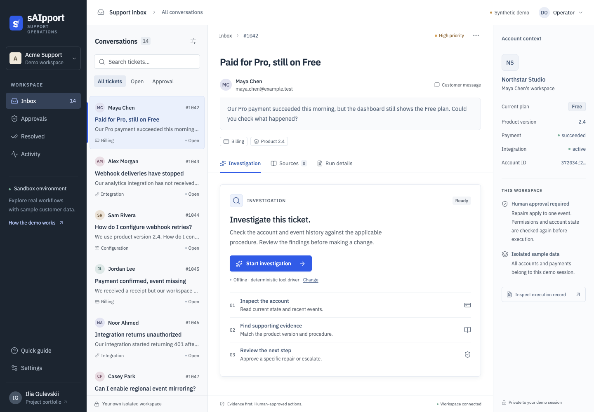

# sAIpport

A support operations workspace that investigates SaaS incidents, gathers evidence, and executes narrowly scoped repairs after a human decision.

[](https://github.com/EshkirenokCode/S-AI-pport/actions/workflows/ci.yml)

[Open the demo](https://saipport.gulevskii.dev) · [Watch the walkthrough](docs/media/walkthrough.webm) · [Architecture](docs/architecture.md) · [Evaluation results](docs/evaluations.md)



## What it does

A customer reports a problem. The investigator reads account and event data through scoped MCP tools, finds the applicable versioned procedure, and returns evidence with a proposed next step. An operator reviews the exact event and expected effect. The worker executes the approved operation once, reads the account again, and prepares a customer reply.

| Workflow | Investigation | Possible outcome |
| --- | --- | --- |
| Paid subscription, missing access | Payment, entitlement, failed event, recovery procedure | Approve reprocessing; verify Pro access |
| Integration stopped delivering | Configuration, attempts, cooldown, destination response | Approve one eligible retry; verify acknowledgement |
| Product setup question | Account version and applicable documentation | Grounded answer, clarification, or escalation |

Permanent credential errors, conflicting payment records, stale state, missing evidence, and a repair without the expected effect require human review. Customer replies remain editable drafts; the application does not send them.

The connected SaaS is a **synthetic, stateful HTTP laboratory** with its own database. Account reads, operation receipts, state changes, and verification actually occur. The demo has no real customers or payment processing.

## Try the demo

Open [saipport.gulevskii.dev](https://saipport.gulevskii.dev). Each visitor receives an isolated workspace with 14 sample tickets. No registration is required.

1. Select **Paid for Pro, still on Free** and choose **Start investigation**.
2. Review the findings and open **Recover a paid subscription v2.1**.
3. Check the proposed event and effect, then choose **Approve & execute**.
4. Confirm **Outcome verified** and the account's **Pro** plan. Edit and save the reply.
5. Try an integration incident or setup question. In **Settings**, create an analyst workspace to test approval restrictions.

The hosted demo runs in **Offline** mode: OpenRouter rejects requests from the demonstration server network with HTTP 403, so Live is disabled there. A locally configured installation can use Live.

**Offline** is a reproducible tool driver using the same real APIs, MCP, policies, worker, and verification. **Live** mode uses a free OpenRouter model to choose tools and write the findings. Live access depends on the configured development key, provider availability, and quotas. Errors stay visible; there is no paid fallback.

[Approval screen](docs/media/approval.png) · [Verified repair](docs/media/repair-verified.png) · [Mobile workspace](docs/media/mobile.png)

## Run locally

With Docker and Docker Compose:

```sh
python3 scripts/configure.py
docker compose up --build --wait
```

Open [localhost:8000](http://127.0.0.1:8000). Configuration generates random private secrets in an ignored `.env`. PostgreSQL and the laboratory have no published ports.

Native development requires Python 3.12+, Node 24+, and PostgreSQL 17:

```sh
make setup
make dev
```

Open [localhost:5173](http://127.0.0.1:5173). The development script uses its own PostgreSQL cluster on port 55432. See [operations](docs/operations.md) for configuration and recovery.

To enable live investigation, set `OPENROUTER_API_KEY` in `.env` and restart API/worker. `OPENROUTER_MODEL` defaults to `openrouter/free`; a pinned `:free` model can also be configured. Each call checks the current zero-price catalog and requires a zero-price provider route. The run records returned model IDs, token usage, reported cost, tool evidence, and outcome. Free-router selection can change between calls.

## Implementation

**Python 3.12 · FastAPI · PostgreSQL 17 · React · TypeScript · Vite · MCP · Docker Compose**

- Durable PostgreSQL jobs with renewable leases, checkpoints, cancellation, and bounded recovery.
- Seven typed tools through a real stdio MCP adapter. Delegated access binds tenant, actor, run, and the current worker lease.
- Version-filtered lexical retrieval using PostgreSQL full-text search, a trusted ticket-family filter, and an evaluated fallback.
- Backend-controlled proposals with an immutable payload, digest, expected account version, and operator-only decisions.
- Idempotent external operations, receipt reconciliation, and fresh verification before declaring a successful repair.
- Tenant-scoped sessions, request/run/model quotas, expiring sample workspaces, private service networks, and a non-root application image.
- Responsive support workspace, SSE with polling fallback, accessible dialogs, persistent local draft edits, and observable execution records.

The model cannot approve its own action, execute arbitrary code, choose another tenant, issue refunds, or change credentials. Search is lexical; semantic embeddings are a documented future option, not an implemented feature.

## Verification

```sh
make check
make test
cd frontend && npx playwright install chromium && npm run test:e2e
```

Integration/browser tests use separate PostgreSQL databases and do not call a live model. CI runs the application suite and an independent container workflow.

```sh
make eval
PYTHONPATH=backend .venv/bin/python scripts/evaluate_retrieval.py
PYTHONPATH=backend .venv/bin/python scripts/compare_retrieval.py
make live  # explicit calls to the configured free model
```

Observed development results, 23 October 2026:

| Check | Result | Scope |
| --- | --- | --- |
| Backend | 41 passing tests | Real PostgreSQL, HTTP laboratory, MCP, permissions, cancellation, recovery, and retention |
| Browser | 13 passing scenarios | Three workflows, decline/roles, draft recovery, keyboard dialogs, outage recovery, 320–1024px layouts, automated WCAG A/AA checks |
| Workflow evaluation | 36/36 expected outcomes; zero duplicate effects | Deterministic driver; 24 development and 12 holdout cases |
| Retrieval | 20/24 baseline → 21/24; long queries 0/6 → 6/6 | Four applicable synthetic documents; lexical retrieval |
| Live development checks | Three canonical families completed; billing also checked on a pinned free model | Stored model/tool traces; provider-reported cost $0 |

These are small synthetic checks, not general LLM accuracy, a complete accessibility audit, or measured production impact. Historical live failures are retained alongside successful runs. See [methodology and raw reports](docs/evaluations.md) and the [release audit](docs/release-audit.md).

## Deployment and boundaries

[Public demo deployment](deploy/README.md) describes the separate Compose stack, reverse proxy, HTTPS, quotas, backup, and rollback. Runtime secrets remain outside Git. The demo is separate from the author's portfolio and other server applications.

This release is a runnable portfolio demonstration. Production adoption requires real business connectors, production identity and access management, organization-specific policies, and validation against real support cases. The laboratory's destination acknowledgement is simulated state, not a request to an external receiver. See [limitations](docs/limitations.md).

## Project notes

[Product plan](docs/plan.md) · [API/tool contracts](docs/contracts.md) · [Security model](docs/security.md) · [Test strategy](docs/testing.md) · [Execution ADR](docs/adr/001-execution.md) · [Retrieval ADR](docs/adr/002-retrieval.md) · [Engineering decisions](docs/engineering.md)

Ilia Gulevskii · [gulevskii.dev](https://gulevskii.dev/)
