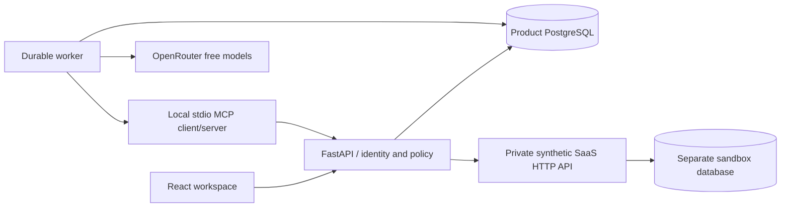

# Architecture

## Boundaries

One repository, two Python HTTP processes, and one worker. Product storage contains tickets, documents, sessions, run checkpoints, tool events, proposals, approvals, audit history, and usage. The synthetic SaaS owns its accounts, subscriptions, payments, deliveries, and operation receipts in a separate database. The product only accesses business state through HTTP.

The SPA is built to static assets and served by FastAPI in production. Vite proxies /api during development. SSR adds no value to this authenticated work surface; avoiding a second application server keeps cookies, deployment, and tracing simpler.

## Durable execution

Runs form a PostgreSQL-backed queue. Workers claim with SELECT FOR UPDATE SKIP LOCKED, establish a renewable lease, and checkpoint after each completed tool call. Expired leases can be recovered. Waiting approvals release the lease. An approval atomically queues the execution phase. Runs have deadlines, bounded acquisition attempts, tool and model-call limits, and cancellation flags.

An external action uses the immutable proposal ID as its idempotency key. A receipt can be read after an ambiguous HTTP failure. Re-delivery of the same operation cannot repeat the business effect. Verification is a fresh read, independent of the model's prose.

## Data model

| Entity | Key contents |
| --- | --- |
| tenants / actors / sessions | Isolated workspace, role, expiring hashed session token |
| tickets | Subject, body, family, account reference, scenario, status |
| runs | Tenant/actor, state/phase, lease, deadline, checkpoint, outcome, usage |
| events | Ordered observable steps, evidence, tool errors, correlation ID |
| actions | Immutable payload/digest, preconditions, approval, execution state |
| audit | Actor, object, decision, timestamp, trace |
| documents | Tenant, stable source key, version, applicability, text, search index |
| model_calls | Actual model, token counts, latency, reported cost, prompt version |
| sandbox state / receipts | Account and delivery state, version, idempotent effects |

## Retrieval

A measured PostgreSQL full-text baseline is retained for comparison. The current retriever filters by trusted ticket topic and product version, first tries the full query, and falls back to disjoined terms only when no document matches. Source references identify document key, version, and exact excerpt. Semantic retrieval and pgvector are deferred until a measured comparison justifies them; they are not implemented. The retrieval ADR records the comparison and remaining misses.

## Identity and tools

A high-entropy HTTP-only cookie identifies a server-side session. Tenant and actor are never chosen by the model. The worker creates a signed, expiring, run-bound context for its local MCP subprocess. The MCP adapter forwards validated tool invocations to the same backend policy/registry used by direct transport. The adapter cannot approve or execute repairs. The trusted worker executes already-approved proposals.

## Deployment

Docker Compose supplies PostgreSQL, sandbox, API, and worker with health checks and explicit limits. The local development fallback uses a dedicated database cluster/port and Python virtual environment. Existing databases and services are not reused.
